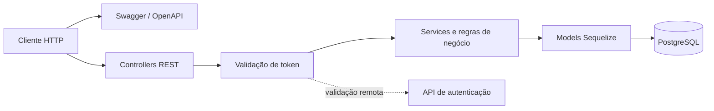

# API de Gerenciamento de Obras Públicas

API REST para centralizar informações e processos relacionados ao acompanhamento de obras públicas. A aplicação gerencia obras, etapas, diários, fiscalizações, relatórios, materiais, equipamentos, fornecedores, endereços e responsáveis técnicos.

Projeto desenvolvido em equipe com **NestJS**, **Sequelize**, **PostgreSQL**, **Swagger** e **Docker**.

## Destaques técnicos

- API REST modular organizada por domínios
- Modelagem de relacionamentos entre obras, equipamentos, fornecedores e responsáveis técnicos
- Relacionamentos N:N e operações de gerenciamento de vínculos
- Filtros por status, obra e relacionamento
- Validação de DTOs com `class-validator`
- Integração com serviço externo para validação de autenticação
- Documentação interativa com Swagger
- Ambiente reproduzível com Docker Compose
- Scripts para testes unitários, integração, cobertura e lint

## Tecnologias


- Node.js
- TypeScript
- NestJS 11
- Sequelize e Sequelize TypeScript
- PostgreSQL 14
- Swagger / OpenAPI
- Docker e Docker Compose
- Jest e Supertest

## Domínios

- Obras
- Endereços
- Etapas da obra
- Diários de obra
- Fiscalizações
- Relatórios
- Materiais
- Equipamentos
- Fornecedores
- Responsáveis técnicos

## Arquitetura



Cada domínio contém controllers, services, DTOs e models. O Sequelize gerencia a persistência e os relacionamentos, enquanto o Swagger documenta os contratos HTTP.

## Funcionalidades

### Obras e etapas

- Cadastro, consulta, atualização e exclusão de obras
- Gerenciamento das etapas associadas a cada obra
- Consulta de dados detalhados e relacionamentos

### Fiscalizações e relatórios

- Consulta de fiscalizações recentes
- Filtros por status e obra
- Atualização do estado de fiscalizações
- Associação de relatórios às fiscalizações

### Recursos e fornecedores

- Gerenciamento de materiais e equipamentos
- Associação de equipamentos e fornecedores às obras
- Ativação e desativação de fornecedores

### Responsáveis técnicos

- Cadastro e manutenção de responsáveis técnicos
- Criação e remoção de vínculos com obras
- Consulta de vínculos específicos

## Como executar

### Pré-requisitos

- Docker
- Docker Compose

### Configuração

Clone o projeto:

```bash
git clone https://github.com/levyath/Api_Gerenciamento_de_obras.git
cd Api_Gerenciamento_de_obras
```

Crie um arquivo `.env` na raiz:

```env
NODE_ENV=development
DB_HOST=db
DB_PORT=5432
DB_EXT_PORT=15432
DB_DATABASE=obras
DB_USER=postgres
DB_PASSWORD=postgres
TOKEN_VALIDATOR_API_URL=http://host.docker.internal:3001/auth/validate
```

> Os valores acima são exemplos para desenvolvimento local. Não versione credenciais reais.

### Subir a aplicação

```bash
docker compose up --build -d
```

Verifique os containers:

```bash
docker compose ps
```

Para acompanhar os logs:

```bash
docker compose logs -f api
```

Para encerrar:

```bash
docker compose down
```

## Documentação da API

Com a aplicação em execução, acesse:

```text
http://localhost:3000/docs
```

O Swagger apresenta os endpoints, parâmetros, DTOs e respostas disponíveis em cada domínio.

## Execução sem Docker

```bash
npm install
npm run start:dev
```

Nesse modo, configure `DB_HOST`, `DB_PORT` e as demais variáveis para apontar para uma instância PostgreSQL acessível pela máquina local.

## Testes e qualidade

```bash
# Testes unitários
npm run test

# Testes end-to-end
npm run test:e2e

# Cobertura
npm run test:cov

# Lint
npm run lint
```

## Projeto em equipe

Este projeto foi desenvolvido de forma colaborativa. O histórico de commits e pull requests registra a participação dos contribuidores nas diferentes funcionalidades.

Consulte a página de [contribuidores](https://github.com/levyath/Api_Gerenciamento_de_obras/graphs/contributors) para conhecer as contribuições do projeto.

